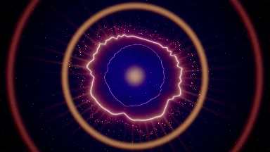
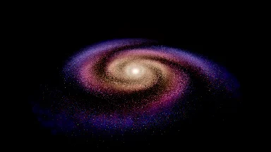
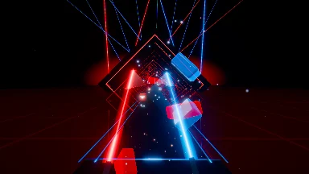

# Pulse

Real-time audio visualizer for desktop and browser. 47 modes, HDR rendering with bloom, playlists with seamless transitions and direct system audio capture on Windows.

<p>
  
  
  
</p>

## Features

- **47 modes** in six categories: organic, particles, retro, ambient, line art and signature
- **HDR pipeline** with bloom, AgX tone mapping, chromatic aberration, film grain and vignette
- **12 transitions** between modes, optionally synced to the beat
- **Playlists, shuffle and single mode** with per-item duration, palette and transition, import and export as JSON
- **Audio analysis** with multi-resolution FFT, auto gain, beat and BPM detection
- **System audio without detours**: WASAPI loopback in the desktop app, any input or output device
- **Now playing** with cover art from the Windows media controls (Spotify, browsers, Apple Music, VLC …)
- **Palettes** that can be applied to every mode, and dynamic resolution for weaker GPUs

## Requirements

| Tool | Version | Used for |
|---|---|---|
| [Node.js](https://nodejs.org) | 22 or newer | Frontend |
| [pnpm](https://pnpm.io) | 10 or newer | Package management |
| [Rust](https://rustup.rs) | stable | Desktop app only |
| MSVC Build Tools | current | Desktop app on Windows only |

On Windows, install Rust with `winget install Rustlang.Rustup`. The build tools come with the Visual Studio Installer (workload "Desktop development with C++"). WebView2 already ships with Windows 11.

## Quick start

```bash
git clone https://github.com/byGamsa/pulse-audio-visualizer.git
cd pulse-audio-visualizer
pnpm install
pnpm dev
```

The app now runs at http://localhost:1420. In the browser, system audio comes in via screen sharing, so tick "Share system audio". Without your own music, the built-in demo beat is enough.

For the desktop app:

```bash
pnpm tauri dev
```

## Scripts

| Command | Description |
|---|---|
| `pnpm dev` | Vite dev server with hot reload |
| `pnpm build` | Type check and production build into `dist/` |
| `pnpm preview` | Serve the build locally |
| `pnpm typecheck` | Type check only |
| `pnpm tauri dev` | Desktop app in development mode |
| `pnpm tauri build` | Build the desktop installers |

Run the Rust tests with:

```bash
cargo test --manifest-path src-tauri/Cargo.toml
```

## Building

### Web

```bash
pnpm build
```

The output in `dist/` can be served by any static web server.

### Desktop

```bash
pnpm tauri build
```

The installers end up in `src-tauri/target/release/bundle/` (`nsis/*.exe` and `msi/*.msi`). Prebuilt installers are available under [Releases](https://github.com/byGamsa/pulse-audio-visualizer/releases).

## Controls

| Key | Action |
|---|---|
| `←` `→` | Previous / next mode |
| `M` | All modes |
| `P` | Playback and playlists |
| `Space` | Hold the current mode |
| `S` | Settings |
| `F` | Fullscreen |
| `H` | Toggle HUD |
| `Esc` | Close open panels |

## Project structure

```
src/
  audio/      Audio sources (Web Audio, native) and FeatureBus
  engine/     Render loop, transitions, palettes, mode registry
    field/    Shared audio field, lines and dot grids
    text/     Glyph atlas and text grid for the retro modes
  modes/      One folder per mode
  media/      Now playing
  store/      Settings and playlists (zustand)
  ui/         React interface
  dev/        Dev server only tools
src-tauri/    Desktop shell in Rust (capture, analysis, media controls)
public/thumbs Mode thumbnails
```

## Adding a new mode

1. Create `src/modes/<id>/index.ts` that default-exports a `ModeDefinition`
2. Register the mode in `src/engine/ModeRegistry.ts` with name, category, description and `gpuCost`
3. Add a fallback cover in `src/ui/modeArt.ts`
4. With the dev server and the demo beat running, call `await __captureThumbnails(['<id>'])` in the console; the thumbnail lands in `public/thumbs`

A mode receives the `AudioFeatures` every frame and draws into an HDR target (RGBA16F, linear). Bloom, tone mapping and transitions are handled by the engine.

## Contributing

Contributions are welcome. Nobody can push to `main` directly, every change goes through a pull request.

1. Fork and clone the repository
2. Create a branch from `main`, e.g. `feat/new-mode` or `fix/beat-detection`
3. Commit using [Conventional Commits](https://www.conventionalcommits.org):
   - `feat: …` new feature
   - `fix: …` bug fix
   - `chore: …` maintenance, dependencies, tooling
   - `refactor: …`, `docs: …`, `test: …`
4. Check locally before pushing:
   ```bash
   pnpm typecheck
   pnpm build
   cargo test --manifest-path src-tauri/Cargo.toml
   ```
5. Open a pull request against `main` and fill in the template. For visible changes, please attach a screenshot or a short video
6. CI has to pass and a maintainer has to approve the PR. PRs are squash merged

See [CONTRIBUTING.md](CONTRIBUTING.md) for details. Please report bugs and ideas as an [issue](https://github.com/byGamsa/pulse-audio-visualizer/issues).

### Rules for `main`

- Changes only via pull request, at least one approval from the code owner
- CI (type check, build, Rust tests) must pass
- The branch must be up to date and all review comments resolved
- Linear history, no force pushes, the branch cannot be deleted

## Versioning

Releases follow [Semantic Versioning](https://semver.org). Every version gets a `vX.Y.Z` tag and a GitHub release with changelog and, from v0.3.0 on, Windows installers.

## License

[MIT](LICENSE)
